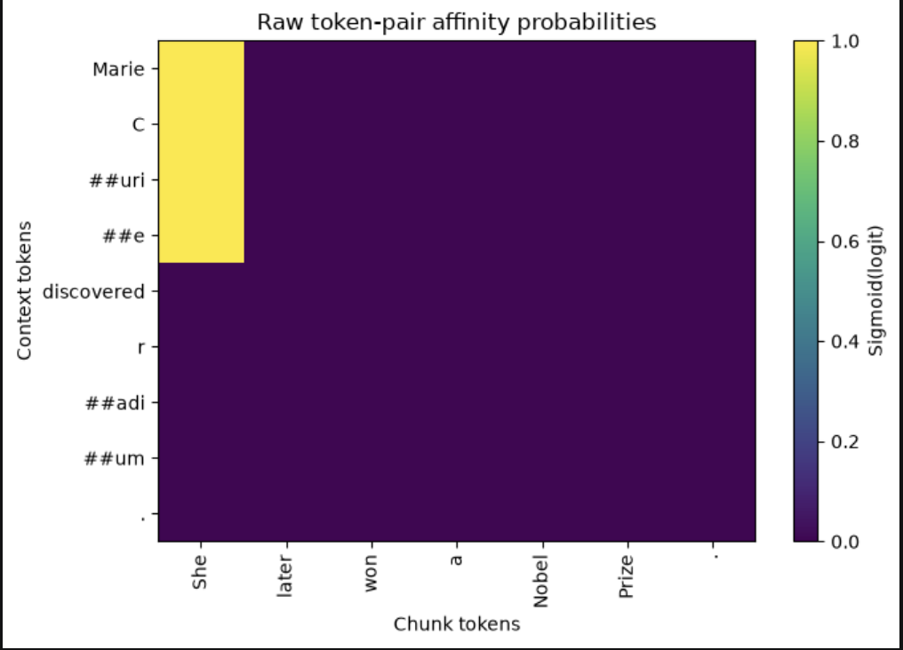

# Cross-Boundary Coreference Resolution

Coreference resolution is a natural language processing (NLP) task that identifies words or phrases in a text that refer to the same real-world person, place, object, or concept. It is a fundamental task in natural language understanding and has been studied in various forms since at least the 1960s.

One useful application of coreference resolution is recovering information that is missing when a piece of text is taken out of its original context.

Consider the sentence:

> "She won the Nobel Prize later that year."

On its own, we have no way of knowing who *she* refers to or which year is being discussed.

Now imagine that the preceding paragraph contains:

> "In 1911, Marie Curie was working in Paris."

With this context, we can resolve the references in the original sentence:

> "She [Marie Curie] won the Nobel Prize later that year [1911]."

The sentence can now be understood independently of the surrounding text.

This becomes particularly useful in the age of large language models (LLMs) and retrieval-augmented generation (RAG). In RAG applications, documents are commonly divided into smaller chunks that can be retrieved and used to ground answers. However, chunk boundaries often separate references from the information needed to understand them.

For example, a retrieved chunk may contain *"she"*, *"the company"*, or *"this discovery"* without including the person, organization, or event being referenced.

The model in this repository addresses this problem by identifying references between a text chunk and its preceding context. These relationships can then be used to enrich chunks before they are stored or retrieved, preserving important information without requiring larger chunks.

Beyond this practical application, the project explores two ideas:

- **Observability:** Rather than directly producing coreference clusters, the model generates a token-pair affinity matrix that exposes learned relationships between context and chunk tokens. These scores can be inspected, visualized, and decoded using different strategies.
- **Computational efficiency:** In our benchmarks, the model achieves competitive cross-boundary reference resolution performance with lower inference latency than the evaluated conventional coreference systems.

# Model Architecture

The architecture takes inspiration from the attention mechanism used in Transformers.

Rather than directly predicting entity spans or coreference clusters, the model learns a representation of relationships between tokens in two pieces of text: a **context** and a **chunk**.

The input is processed by a DistilBERT encoder. A bilinear affinity head then computes a score for each pair of context and chunk tokens.

The result is a two-dimensional affinity matrix:

$A \in \mathbb{R}^{|C| \times |Q|}$

where $(C)$ represents the context tokens and $(Q)$ represents the chunk tokens.

Each entry $(A_{ij}$) represents the model's estimated affinity between context token $(i)$ and chunk token $(j)$.

During training, the model is encouraged to assign higher scores to token pairs belonging to annotated antecedent–anaphor relationships. Because these relationships involve spans rather than individual tokens, they appear as rectangular regions in the affinity matrix.

This representation has two useful properties.

First, it provides **observability**. We can inspect the affinity matrix to see which tokens the model associates with one another, including competing references and potential errors.

Second, it separates representation learning from relation extraction. The affinity matrix can be processed by different decoding strategies. This repository includes a deterministic rectangle decoder that identifies high-affinity regions and converts them into antecedent–anaphor span pairs.

# Training and Data

The model is trained using a three-stage curriculum, gradually introducing more diverse and challenging examples.

**Stage 1 — Rule-based examples**

The model is initially trained on rule-based coreference examples generated from predefined templates. These examples introduce basic reference patterns in a controlled setting.

**Stage 2 — Synthetic examples**

Training continues with a mixture that introduces synthetically generated examples, including examples produced using LLMs. These provide more varied and realistic language than the initial templates.

**Stage 3 — Real-world and adapted coreference data**

The model continues training from the previous checkpoint using a broader mixture of annotated real-world text and datasets adapted for cross-boundary reference resolution.

The training data includes:

- [Rule-based examples](https://huggingface.co/datasets/mhaugestad/cross-boundary-coref-rule-based)
- [Synthetic examples](https://huggingface.co/datasets/mhaugestad/cross-boundary-coref-synthetic)
- [LLM-annotated real-world examples](https://huggingface.co/datasets/mhaugestad/cross-boundary-coref-llm-annotated)
- [GAP adapted for cross-boundary coreference](https://huggingface.co/datasets/mhaugestad/cross-boundary-coref-gap)
- [LitBank adapted for cross-boundary coreference](https://huggingface.co/datasets/mhaugestad/cross-boundary-coref-litbank)
- [OntoNotes adapted for cross-boundary coreference](https://huggingface.co/datasets/mhaugestad/cross-boundary-coref-ontonotes)

The exact training schedule, dataset composition, and hyperparameters are defined in the repository's training configuration.

# Benchmarking

We evaluate the model against two established coreference resolution systems, F-coref and LingMess, using test sets derived from GAP, LitBank, and OntoNotes.

All models are evaluated on the same context–chunk examples. Conventional coreference models produce mention clusters, which are converted into cross-boundary antecedent–anaphor predictions using a deterministic post-processing procedure.

The benchmark uses **pair-based scoring**, where multiple annotated antecedent pairs are counted separately, and each predicted anaphor is assigned at most one antecedent.

The table reports exact relation F1 and median inference latency per example in milliseconds.

| Model | GAP (1,524) | LitBank (601) | OntoNotes (8,055) |
|---|---|---|---|
| **Cross-Boundary Coreference** | **0.4431 / 17.3 ms** | 0.2272 / 17.6 ms | 0.3651 / 16.7 ms |
| F-coref | 0.3869 / 27.4 ms | 0.2591 / 28.7 ms | 0.4680 / 25.9 ms |
| LingMess | 0.4188 / 592.6 ms | **0.2718 / 595.4 ms** | **0.4876 / 595.9 ms** |

**Inference environment:** Apple M1 with 16 GB RAM, batch size 1, and float32 precision. Neural models used MPS. Timings include tokenization and post-processing, but exclude model loading and one warm-up example.

The results show that the lightweight DistilBERT-based model achieves the highest exact relation F1 among these systems on GAP, while F-coref and LingMess achieve higher scores on LitBank and OntoNotes.

At the same time, the affinity model has the lowest measured inference latency across all three datasets, approximately 1.5–1.7 times faster than F-coref and 35 times faster than LingMess in this environment.

These results suggest that a relatively small encoder with a simple affinity head can provide a useful balance between reference-linking performance and computational efficiency.

**Benchmark limitations:** These are cross-boundary relation extraction scores, not standard end-to-end coreference benchmark scores. The datasets have different annotation conventions, and pair-based scoring may penalize systems that predict only one of several valid antecedent mentions. Two exact training/test text overlaps were identified in OntoNotes, and document-level training overlap for GAP has not been fully established. Results should therefore be interpreted with these limitations in mind.